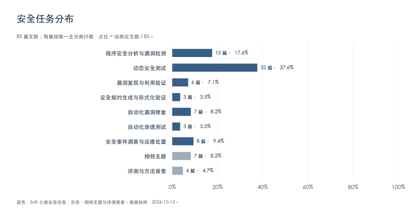
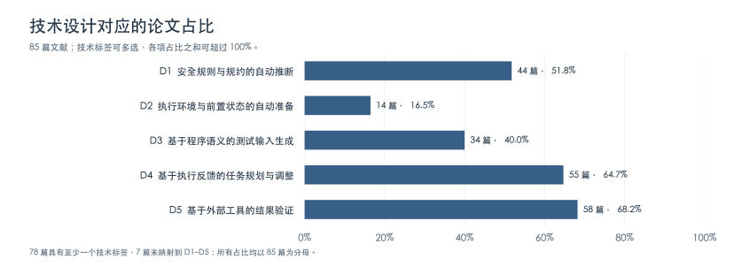

# Agentic System 在安全研究中的应用与技术贡献

> [文献目录](../README.md) · [分类映射](mapping.md) · [来源说明](provenance.md)

Agentic System 将大语言模型（Large Language Model, LLM）与程序分析器、测试工具及执行环境结合，由模型读取代码和运行记录、调用工具，并根据执行结果选择后续操作。这类系统已用于漏洞检测、动态测试、漏洞复现、补丁修复和安全运维。

本文关注一个问题：**Agentic System 如何解决传统安全技术面临的困难？** 我们梳理安全四大会议的相关研究，分析现有方法受限的原因、Agentic System 采用的技术设计，以及实验结果对这些设计的支持程度。

## 1 研究范围与文献检索

本文收录 2025–2026 年 IEEE S&P、USENIX Security、ACM CCS 和 NDSS 已录用的相关论文，并补充截至 2026 年 10 月 12 日由作者或机构确认录用的 2027 年工作。检索以会议录用名单和议程为入口，结合 LLM、agent、fuzzing、testing、repair、program analysis 等关键词及论文的研究目标筛选候选，再核对录用信息与公开全文。共纳入 **85 篇文献**，涵盖研究系统、用于比较的技术方法，以及评测与综述。

分析范围包括由模型选择后续操作的 Agent，以及按预设流程调用 LLM 和安全工具的系统。比较时区分模型生成规则或代码的作用、执行反馈的作用，以及运行过程中选择后续操作的作用。

## 2 传统安全任务及其技术挑战

[SoK: Automated Vulnerability Repair: Methods, Tools, and Assessments（USENIX Security 2025）](https://www.usenix.org/conference/usenixsecurity25/presentation/hu-yiwei) 按漏洞分析、补丁生成和补丁验证组织自动化修复研究。参考这种按任务目标组织文献的方式，本文将收集的研究分为七类，分别讨论其分析对象、执行条件和传统方法的局限。

图 1 给出 85 篇文献的主分类分布。每篇只计入一类，占比以全部 85 篇为分母。七类安全任务之外，还收录了相邻主题（7 篇）和评测与方法背景（4 篇）。

1. **程序安全分析与漏洞检测（Program Analysis and Vulnerability Detection；15 篇，17.6%）**

   程序安全分析通过检查源代码或二进制程序识别安全缺陷。污点分析（Taint Analysis）和数据流分析（Data-flow Analysis）可以追踪数据传播与函数调用关系，但漏洞判定通常需要预先定义敏感数据来源、危险操作及必要的检查条件。访问控制等缺陷还依赖应用的业务语义：同一接口允许哪些用户调用、用户可以操作哪些资源，都可能由业务代码、配置和跨服务调用共同决定。通用规则难以完整表达这些要求，分析人员需要提取应用特定的权限条件，并检查实现是否遵守这些条件。

2. **动态安全测试（Dynamic Security Testing；32 篇，37.6%）**

   动态安全测试通过执行程序发现安全缺陷，常用方法包括模糊测试（Fuzzing）和黑盒安全扫描，也可结合符号执行（Symbolic Execution）探索执行路径。测试输入需要满足格式、参数关系和调用顺序等约束。文件解析器可能在解析阶段拒绝格式错误的输入，Web 功能则可能要求先完成登录和对象创建。随机变异难以同时满足这些条件，符号执行也受到路径爆炸和外部环境建模的限制。即使输入到达目标代码，触发漏洞仍可能需要特定的参数取值或程序状态，因而覆盖率与漏洞发现数量需要分别评价。

3. **漏洞复现与利用验证（Vulnerability Reproduction and Exploit Validation；6 篇，7.1%）**

   漏洞复现根据已有报告或漏洞线索，在受影响的软件中触发目标缺陷，并核实其安全影响。复现通常需要恢复软件版本、依赖与配置，准备初始状态，再构造概念验证程序（Proof of Concept, PoC）。公开报告经常缺少完整的构建步骤、前置操作或可执行 PoC，分析人员因而需要补齐这些条件。运行失败、目标代码不可达和漏洞未触发分别需要不同的处理。程序崩溃还可能由其他缺陷引起，必须核对崩溃位置、原因或预期安全影响，才能确认目标漏洞已被复现。

4. **安全规约生成与形式化验证（Security Specification and Formal Verification；3 篇，3.5%）**

   形式化验证通过模型检查（Model Checking）或定理证明（Theorem Proving），检查程序是否满足给定的安全性质。验证需要明确程序不变量（Invariants）、函数的前置条件与后置条件，以及外部函数和运行环境的行为假设。这些信息通常分散在设计文档、API 使用约定和程序实现中，需要专家提取并写成规约。遗漏安全性质会缩小检查范围，过强的环境假设可能排除真实缺陷，过弱的环境模型则可能产生伪反例。验证结论因此同时受规约、分析范围和环境假设约束。

5. **自动化漏洞修复（Automated Vulnerability Repair；7 篇，8.2%）**

   自动化漏洞修复需要定位漏洞根因、生成补丁，并检查补丁是否消除漏洞且保留正常功能。自动程序修复（Automated Program Repair, APR）通常通过模板、程序搜索或约束求解生成候选补丁，再运行测试进行筛选。安全缺陷可能涉及跨函数的权限检查、数据处理或状态更新，仅修改局部可疑语句可能遗漏根因。有限的测试还可能接受只阻止已知 PoC、却保留其他触发路径的补丁，即补丁过拟合（Patch Overfitting）。修复验证需要同时检查漏洞是否仍可触发，以及补丁是否引入功能回归。

6. **自动化渗透测试（Automated Penetration Testing；3 篇，3.5%）**

   渗透测试通过信息收集、漏洞利用、权限提升和横向移动等操作评估系统安全性。端口扫描、漏洞匹配与已知漏洞利用已有专门工具支持，但多阶段攻击还需要维护主机、服务、凭据和权限信息。例如，入侵一台主机后获得的凭据，可能使内部服务成为新的可达目标；一次操作失败也可能要求更换利用方式或攻击路径。预定义流程难以枚举这些状态变化，系统需要依据当前权限、网络可达性和执行结果决定后续操作。

7. **安全事件调查与运维处置（Security Investigation and Operational Remediation；8 篇，9.4%）**

   安全事件调查从日志、网络流量和告警中识别恶意活动并重建攻击过程。单个告警通常只描述局部异常，完整调查需要关联不同主机、进程和时间点的事件，核实它们是否属于同一次攻击。正常业务活动与攻击行为混杂，也增加了证据筛选与因果分析的难度。后续处置还受到维护窗口、审批和服务可用性要求的约束：当前允许执行的动作，可能使系统进入后续操作无法满足策略的状态。因此，事件关联与处置规划都需要保留历史证据，并检查操作对后续状态的影响。

## 3 Agentic System 的关键技术设计

安全规则、测试输入和操作计划都需要适应目标程序。Agentic System 使用 LLM 分析代码、文档与执行记录，将分析结果转化为查询、规约、测试程序或工具命令，再根据检查结果修正这些产物。参考 [SoK: DARPA's AI Cyber Challenge (AIxCC): Competition Design, Architectures, and Lessons Learned（USENIX Security 2026）](https://www.usenix.org/conference/usenixsecurity26/presentation/zhang-cen) 对安全分析系统的研究，本文从规则推断、环境准备、输入生成、反馈调整和结果验证五个方面比较这些设计。

图 2 给出五项技术设计对应的文献分布。占比以全部 85 篇为分母，一篇论文可在多项技术下分别计数；未映射到这五项技术的 7 篇文献仍计入分母。逐篇对应及标签定义见[文献映射](mapping.md)。

### 3.1 安全规则与规约的自动推断（Security Rule and Specification Inference；44 篇，51.8%）

规则推断需要确定程序应满足什么安全条件，并将这些条件写成工具可检查的形式。系统通过代码查询和文档检索获取权限检查、接口定义和调用上下文，由模型生成候选规则，再利用静态分析、动态执行或形式化工具检查生成结果。

[BACAgent](https://lfysec.github.io/paper/bacagent-ccs26.pdf) 结合静态调用信息、会话数据、业务代码与框架文档，推断接口的访问控制要求，并检查实现中是否缺少必要的权限检查。[NEO](https://arxiv.org/abs/2605.15569) 通过代码查询按需获取跨语言、跨服务的调用与鉴权信息，分析特权操作的访问路径。[MoCQ](https://peng-hui.github.io/data/paper/ccs26:mocq.pdf) 从已有漏洞样例中提取检测模式，生成静态分析查询，并依据语义反馈和查询结果修正规则。

[GPTAid](https://www.ndss-symposium.org/wp-content/uploads/2025-465-paper.pdf) 根据 API 实现生成参数使用规则，再构造遵守和违反候选规则的调用程序，通过运行结果筛选与细化规则。[PropertyGPT](https://www.ndss-symposium.org/wp-content/uploads/2025-1357-paper.pdf) 检索已有人工规约，为目标智能合约生成安全性质，按编译反馈修正后交由验证工具检查。[SPAR](https://www.usenix.org/system/files/usenixsecurity26-ye.pdf) 同时生成协议格式规范与参考解析器，构造测试输入比较两者的判断，再修正规范或解析器。

这类方法将应用特定的安全要求转化为检测规则或验证条件。评价需要分别检查规则是否符合程序及规范要求，以及规则能否用于发现缺陷。生成结果可以执行，或两个生成产物相互一致，都只能支持相应检查范围内的结论。

### 3.2 执行环境与前置状态的自动准备（Environment and State Preparation；14 篇，16.5%）

环境与状态准备包括安装依赖、恢复软件配置，以及执行登录、对象创建等前置操作。系统需要从代码、文档或页面中确定这些要求，调用命令行或浏览器执行操作，再检查目标程序是否能够运行、所需状态是否已经建立。

[YuraScanner](https://www.ndss-symposium.org/wp-content/uploads/2025-388-paper.pdf) 以业务任务驱动 Web 应用探索。Agent 根据页面内容和历史操作选择后续交互，通过浏览器执行，使扫描器能够访问需要多步操作才能到达的功能。[CVE-Genie](https://sites.cs.ucsb.edu/~chris/research/doc/ccs26_cvegenie.pdf) 根据 CVE 描述、源码与文档恢复漏洞环境，执行安装、配置与运行检查，并根据错误日志修改准备步骤。

[Firmenstein](https://www.usenix.org/system/files/usenixsecurity26-wang-yanzhong.pdf) 通过 API 依赖图分析固件服务的环境依赖，生成干预代码，使服务能够在仿真环境中继续运行；运行失败后的迭代仍需人工参与。[AutoSOUP](https://arxiv.org/abs/2605.10712) 则面向组件级内存安全验证，构造验证范围、循环界限和环境模型，并结合调用上下文检查前置条件。

环境准备的效果应通过目标程序的运行结果和状态检查评价。固件干预代码还需要检查是否改变了待分析行为，验证环境中的假设则需要与调用方及外部环境保持一致。

### 3.3 基于程序语义的测试输入生成（Semantics-Guided Test Generation；34 篇，40.0%）

语义引导的输入生成从代码与文档中提取格式、参数关系和调用依赖，并将其编码为测试入口程序（Harness）、输入生成器或变异器。测试工具随后批量生成和执行输入，使模型推断的约束可以在多轮搜索中复用。

[PromeFuzz](https://raw.githubusercontent.com/TCA-ISCAS/PromeFuzz-ccs-2025/master/paper/ccs25-full.pdf) 结合 API 依赖、文档检索与编译和运行反馈生成 Harness。[SynapseFlow](https://arxiv.org/abs/2607.07007) 根据函数间的数据流聚合相关 API，通过分阶段生成和失败回退处理初始化、调用顺序及资源清理问题。[ELFuzz](https://www.usenix.org/system/files/usenixsecurity25-chen-chuyang.pdf) 生成并筛选可执行的输入生成器，为模糊测试提供种子；[PDFuzzer](https://sites.cs.ucsb.edu/~chris/research/doc/ccs26_pdffuzz.pdf) 从文档提取 API 规范和调用约束；[Bulbasaur](https://www.usenix.org/system/files/usenixsecurity26-wang-yiyi.pdf) 则针对未覆盖分支，结合代码上下文和运行时信息生成变异器。

[PBFuzz](https://arxiv.org/abs/2512.04611) 分析目标漏洞的可达性约束（Reachability Constraints）与触发约束（Triggering Constraints），据此构造参数化输入生成器，再通过基于性质的测试（Property-Based Testing）搜索触发输入。[GONDAR](https://arxiv.org/abs/2604.01645) 将两类约束交给不同 Agent 处理：探索 Agent 与模糊测试协作生成能够到达危险操作（Sink）的输入，利用 Agent 再依据该操作的语义修改输入，尝试触发漏洞。

这些设计把格式知识、API 依赖和漏洞条件用于输入搜索。执行反馈可用于判断生成的输入在哪一步被拒绝，并据此补充约束；评价时仍需分别报告输入有效率、代码覆盖率和经确认的漏洞发现结果。

### 3.4 基于执行反馈的任务规划与调整（Feedback-Guided Planning and Execution；55 篇，64.7%）

反馈调整需要从工具输出中识别失败原因，并确定后续操作。例如，脚本报错后需要修改分析代码，补丁测试失败后需要重新检查修复位置，攻击失败后则可能需要更换目标或利用方式。系统还需要保存已有发现，避免重复执行已失败的操作或丢失后续步骤所需的信息。

[BINREX](https://www.usenix.org/system/files/usenixsecurity26-liu-yuzhe.pdf) 通过语义检索定位相关二进制函数，将分析目标拆分为子任务，生成 IDAPython 脚本，并依据执行结果和局部检查条件修正脚本。[PatchAgent](https://www.usenix.org/system/files/usenixsecurity25-yu-zheng.pdf) 使用语言服务器查询代码，将漏洞定位、补丁生成与验证连接起来，根据编译和测试反馈修改候选补丁。[AhFuzz](https://abhikrc.com/pdf/NDSS27.pdf) 则根据覆盖、种子和目标执行记录，选择并配置模糊测试与具体符号执行（Concolic Execution）工具。

[Incalmo](https://arxiv.org/abs/2501.16466) 将网络扫描、主机入侵等高层任务交给专门的执行模块，再由模块调用底层工具。独立的状态管理服务保存主机、服务、凭据和攻击进展，供后续规划使用。

比较这类系统时，需要检查反馈是否改变了后续操作，以及状态记录是否减少了重复探索或信息遗漏。按固定顺序修正生成结果与由模型选择下一步工具，具有不同的控制方式，应分别分析其贡献。

### 3.5 基于外部工具的结果验证（Tool-Based Validation；58 篇，68.2%）

结果验证需要检查生成产物是否满足安全任务的目标。编译器可以发现语法和类型错误，动态测试可以检查漏洞是否触发或补丁是否通过已有用例，形式化工具则在给定规约和假设下检查安全性质。系统根据这些检查结果接受、拒绝或修正模型生成的产物。

[CVE-Genie](https://sites.cs.ucsb.edu/~chris/research/doc/ccs26_cvegenie.pdf) 按漏洞类型构造验证逻辑，检查 PoC 是否造成预期安全影响。例如，对未授权删除漏洞，验证器先创建测试数据，再执行未授权请求，最后检查数据是否被删除。[SlicePatch](https://seclab.cse.cuhk.edu.hk/papers/sp26-SlicePatch.pdf) 使用定向差分模糊测试比较补丁前后的程序行为，检查补丁绕过和功能回归，并将发现的问题反馈给补丁生成过程。

[PatchWeaver](https://www.usenix.org/system/files/usenixsecurity26-li-rui.pdf) 将维护窗口、审批和服务可用性要求写成可执行策略，通过模拟操作后的 Kubernetes 状态筛选候选动作。[OCR-APT](https://arxiv.org/abs/2510.15188) 则从审计日志中提取异常子图，分阶段关联攻击事件，并核对提取的实体和证据。日志证据核对与程序性质验证提供不同强度的保证，其适用范围应分别说明。

验证结论受测试用例、安全判据、环境假设和执行范围限制。漏洞复现需要区分目标可达、缺陷触发与安全影响；补丁验证需要同时检查已知漏洞和正常功能；运维验证则需要检查操作后的状态是否满足策略。

### 小结

同一安全任务通常需要组合多项设计。API 误用检测将候选规则转化为调用程序，通过运行结果修正规则；漏洞复现需要恢复环境、构造输入，再核对触发位置与安全影响。模型分析、工具执行与结果检查在这些过程中相互依赖，实验需要检验各环节的作用及其组合后的任务效果。

## 4 实验设计与有效性评估

评估 Agentic System 需要同时检查任务完成情况、结果正确性和改进来源。模型、工具与执行预算都会影响结果。[AIxCC SoK](https://www.usenix.org/conference/usenixsecurity26/presentation/zhang-cen) 对竞赛条件与系统结果的分析，也说明了明确这些条件对解释实验结果的必要性。常见评估包括以下四个方面。

1. **端到端任务效果（End-to-End Effectiveness）。** 在真实软件、公开漏洞或标准化环境中，将系统与现有安全工具、通用 LLM Agent 和固定工作流比较。指标应对应任务目标，包括漏洞检测的准确率与召回率、测试覆盖率与经确认的漏洞数量、漏洞复现成功率，以及补丁通过哪些正确性检查。不同系统获得的输入信息、运行环境和漏洞判据需要明确列出，以便判断其成功率是否可比。

2. **关键设计的消融分析（Ablation Study）。** 在相同模型与实验条件下，逐项移除或替换设计，检查结果变化。[BACAgent](https://lfysec.github.io/paper/bacagent-ccs26.pdf) 比较按需获取证据与一次性提供全部上下文，用于分析证据获取策略的作用。[PBFuzz](https://arxiv.org/abs/2512.04611) 在相同基础模型下逐步增加执行反馈、分析工具和完整工作流。当一组对照同时改变多个组件时，结果支持的是其组合效果，单项贡献需要独立对照。

3. **结果正确性验证（Result Validation）。** 成功判据应直接检查预期安全结果。可使用动态执行、Sanitizer、专门验证程序或人工核验，并说明各自的检查范围。[CVE-Genie](https://sites.cs.ucsb.edu/~chris/research/doc/ccs26_cvegenie.pdf) 检查 PoC 是否造成预期安全影响，[SlicePatch](https://seclab.cse.cuhk.edu.hk/papers/sp26-SlicePatch.pdf) 通过定向差分模糊测试检查补丁绕过与回归。对于修复任务，应区分补丁生成、编译通过、已有测试通过和经进一步检查确认正确等不同结果。

4. **泛化能力与执行成本（Generalizability and Efficiency）。** 使用不同项目、漏洞类型和基础模型，并通过重复运行检查结果稳定性。[PrivEscalate](https://arxiv.org/abs/2609.09087) 的实验显示，相同规划机制对不同模型的影响存在差异。成本统计应包括知识准备、环境构建、模型调用、工具运行、失败重试和人工干预，并报告 Token 消耗与执行时间。对照实验还应说明预算是按输入、漏洞、项目还是整个任务分配。

## 5 技术贡献与发展方向

Agentic System 将模型的代码与文档分析用于生成可执行的规则、测试程序和操作计划，并利用工具反馈修正生成结果。现有研究在安全规则构建、测试准备和多步骤任务执行中减少了部分人工工作，体现出三方面进展。

**将应用特定安全要求转化为可检查的规则。** 访问控制要求、API 使用约束和程序性质可以从代码与文档中提取，并写成分析查询、测试条件或形式化规约。结合运行结果和验证反例修正规则，有助于处理通用漏洞模式难以覆盖的应用逻辑，也减少了人工编写与调试规则的工作。

**为测试构造所需的环境、状态和输入。** 依赖分析与运行检查用于恢复执行环境，语义分析与输入搜索用于满足格式、调用顺序和漏洞触发条件。两者结合后，系统可以根据失败位置补充配置或修改输入，将原本需要人工准备的条件纳入测试过程。

**依据执行结果推进多步骤安全任务。** 在漏洞修复、渗透测试、事件调查与运维处置中，证据检索和状态记录使系统能够利用已有发现，工具检查则用于决定是否修改补丁、切换攻击步骤或重新安排处置动作。这减少了不同工具操作之间的人工衔接，但也要求系统正确解释失败原因，并使用与任务目标一致的成功判据。

生成规则的错误、缺失的程序状态以及有限的验证范围，仍会导致误报、漏报或错误修复。后续研究需要重点处理以下问题。

1. **生成规则的正确性与覆盖范围。** 从实现中推断安全要求，可能继承已有缺陷或遗漏必要条件。需要结合设计文档、调用上下文和独立测试，检查规则是否符合预期要求，并识别尚未覆盖的行为。

2. **执行前提的表示与检查。** 漏洞复现和多步骤交互通常依赖特定的权限、业务对象和服务配置。需要记录这些依赖，在执行中检查其满足情况，并区分环境准备失败、目标不可达和漏洞未触发，避免使用错误的失败原因指导后续操作。

3. **漏洞触发与修复效果的验证。** 漏洞复现应核实预期安全影响，补丁修复应检查漏洞消除与正常功能保留，运维处置应验证操作后的状态是否满足策略。补充触发路径、回归测试和任务相关的安全判据，可以扩大现有验证的检查范围。

4. **规划收益与执行成本。** 需要在相同模型、工具和预算下比较动态决策与固定工作流，检查哪些步骤受益于模型判断，哪些步骤可以直接由工具完成。跨项目、跨模型与重复实验应同时报告成功案例、失败原因，以及模型、工具和人工开销。

可复核的执行记录、明确的安全判据和一致的资源预算，是比较这些方法并评估其部署条件的基础。
